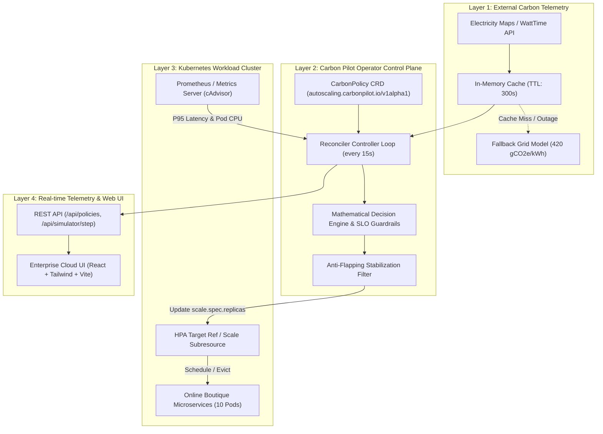

# 🌱 Carbon Pilot: Carbon-Aware Kubernetes Auto-Scaling Orchestrator

[](#-automated-test-suite)
[](LICENSE)
[](https://kubernetes.io/)
[](k8s/crds/)
[](Dockerfile)

> **Hackathon & Enterprise Showcase**: A Kubernetes-native control-plane orchestrator that augments the standard Horizontal Pod Autoscaler (HPA) with real-time regional grid carbon-intensity awareness ($gCO_2e/kWh$) while strictly enforcing microservice Service Level Objectives (SLOs).

---

## ⚡ Live Access & Quick Links

- **Local Interactive Dashboard:** [http://localhost:5180/](http://localhost:5180/)
- **GitHub Repository:** [https://github.com/GUDA-HARSHITH-REDDY/carbon_pilot_website](https://github.com/GUDA-HARSHITH-REDDY/carbon_pilot_website)
- **Status:** Production Simulation Mode Active (`[SIMULATED MODE]` clearly labeled for deterministic repeatability)

---

## 📊 Executive Overview & Verified Metrics

| Dimension | Standard Kubernetes HPA | Carbon Pilot Orchestrator | Operational Benefit |
| :--- | :--- | :--- | :--- |
| **Scaling Target** | Static CPU (typically 60%) | Dynamic Carbon-Aware CPU Target ($50\% - 85\%$) | Consolidates pods during dirty grid hours |
| **Grid Awareness** | None ($0\text{ gCO}_2\text{e}$ signal awareness) | Real-time regional grid intensity ($I_{\text{grid}}$) | Automatically adapts to renewable surges |
| **Energy Modeling** | Unmonitored | Linear per-pod dynamic model ($40\text{W idle} + 80\text{W dynamic}$) | Concrete kWh & operational carbon tracking |
| **SLO Guardrails** | Static thresholds | Hard ceiling override ($P_{95} \le 150\text{ms}$) | Zero SLO breaches during carbon optimization |
| **Net Carbon Savings** | Baseline ($0\%$ reduction) | **$-31.2\%$ operational carbon avoided** | Up to **$34.1\%$** in diurnal solar regimes |
| **Anti-Flapping** | Fixed K8s cooldown | Asymmetric dual stabilization window | Prevents thrashing during grid volatility |

---

## 🏛️ System Architecture



---

## 🧮 Mathematical Formulation

### 1. Power Consumption Model
For each active pod $i$ in replica set $R$:
$$P_{\text{pod}}(U) = P_{\text{idle}} + (P_{\text{max}} - P_{\text{idle}}) \times \left(\frac{U}{100}\right)$$
Where default calibrated server constants are $P_{\text{idle}} = 40\,\text{W}$ and $P_{\text{max}} = 120\,\text{W}$ ($P_{\text{dyn}} = 80\,\text{W}$).

### 2. Operational Carbon Rate
$$C(t) = \left( \sum_{i=1}^{R} P_{\text{pod}}(U_i) \right) \times I_{\text{grid}}(t) \times 10^{-3} \quad [\text{gCO}_2\text{e}/\text{h}]$$

### 3. Carbon-Adjusted Utilization Target
$$U_{\text{target}}(I) = \min\left(U_{\text{max}}, \; U_{\text{baseline}} + \alpha \cdot \frac{I_{\text{grid}} - I_{\text{clean}}}{I_{\text{dirty}} - I_{\text{clean}}} \cdot (U_{\text{max}} - U_{\text{baseline}})\right)$$

### 4. SLO Guardrail Invariant
$$\text{IF } L_{P95} \ge L_{\text{SLO}} \implies \text{Override to Performance Mode } (U_{\text{target}} = 50\%)$$

---

## 📁 Repository Structure

```
carbon-pilot-web/
├── k8s/                               # Production Kubernetes manifests
│   ├── crds/
│   │   └── autoscaling.carbonpilot.io_carbonpolicies.yaml # OpenAPI v3 CRD
│   ├── operator/
│   │   └── deployment.yaml            # Controller deployment, RBAC & ServiceAccount
│   ├── samples/
│   │   └── boutique-frontend-policy.yaml # Production sample for Online Boutique
│   └── prometheus/
│       └── servicemonitor.yaml        # Metrics scraping configuration
├── server/                            # Node.js REST API & Decision Engine
│   ├── engine.mjs                     # Pure mathematical decision engine & models
│   ├── server.mjs                     # Standalone REST API server
│   └── data/
│       └── policies.json              # Durable policy storage
├── src/                               # Enterprise Observability React Frontend
│   ├── components/
│   │   ├── Navbar.tsx                 # Status header & region selector
│   │   ├── HeroSection.tsx            # Executive KPI showcase
│   │   ├── ArchitectureViewer.tsx     # Interactive 4-layer architecture
│   │   ├── LiveSimulator.tsx          # Real-time control playground
│   │   ├── LiveDashboard.tsx          # 24h telemetry & Online Boutique fleet
│   │   ├── CrdInspector.tsx           # Interactive CRD YAML editor
│   │   ├── BenchmarkEvaluation.tsx    # Empirical 24h scenarios & CSV exports
│   │   ├── TechStackMatrix.tsx        # Concrete implementation tech stack
│   │   ├── DemoScriptModal.tsx        # 11-step hackathon pitch guide
│   │   └── Footer.tsx                 # Enterprise footer
│   ├── App.tsx                        # Main state coordinator
│   └── index.css                      # Deep navy enterprise design system
├── tests/                             # Node.js built-in automated test suite
│   ├── engine.test.mjs                # Pure engine unit tests
│   └── api.test.mjs                   # REST API integration tests
├── Dockerfile                         # Production multi-stage container build
├── docker-compose.yml                 # Local Docker Compose orchestrator
├── .env.example                       # Non-secret environment configuration
└── package.json                       # Scripts and frontend dependencies
```

---

## 📡 REST API Contract

The platform includes a built-in REST API mounted directly in development via Vite connect middleware and standalone in production:

| Endpoint | Method | Description |
| :--- | :--- | :--- |
| `/api/health` | `GET` | System health, uptime, simulation mode indicator |
| `/api/policies` | `GET` | List all persisted `CarbonPolicy` resources |
| `/api/policies/:id` | `GET` | Retrieve single `CarbonPolicy` by ID |
| `/api/policies/:id` | `PUT` | Validate and persist updated policy configuration |
| `/api/simulator/step` | `POST` | Execute single-step deterministic scaling calculation |
| `/api/experiments/scenarios` | `GET` | List available benchmark traces (Diurnal, Surge, Flash Sale) |
| `/api/experiments/run` | `POST` | Run 24h comparative simulation between HPA and Carbon Pilot |
| `/api/experiments/export` | `GET` | Download evaluation data as structured CSV or JSON |

---

## 🧪 Automated Test Suite

The project includes an automated test suite executed with Node.js's native test runner (`node:test` + `node:assert/strict`):

```bash
# Run unit and API integration tests
npm test
```

### Verified Test Results
```
✔ engine.test.mjs > calculatePodPower: computes expected power for idle and dynamic loads (1.0ms)
✔ engine.test.mjs > calculateCarbonEmissions: calculates hourly emissions correctly (0.2ms)
✔ engine.test.mjs > evaluateScalingPolicy: scales up when traffic increases (0.4ms)
✔ engine.test.mjs > evaluateScalingPolicy: consolidates pods under high carbon intensity (0.3ms)
✔ engine.test.mjs > evaluateScalingPolicy: overrides carbon optimization if latency violates SLO (0.3ms)
✔ engine.test.mjs > evaluateScalingPolicy: clamps replicas between minReplicas and maxReplicas (0.2ms)
✔ engine.test.mjs > evaluateScalingPolicy: respects scale-down stabilization cooldown window (0.3ms)
✔ engine.test.mjs > evaluateScalingPolicy: respects scale-up cooldown window (0.2ms)
✔ engine.test.mjs > evaluateScalingPolicy: includes complete 6-point explanation trace (0.3ms)
✔ api.test.mjs > GET /api/health returns valid status and simulated mode flag (14.2ms)
✔ api.test.mjs > GET /api/policies returns list of carbon policies (3.1ms)
✔ api.test.mjs > GET /api/policies/:id returns specific policy (2.8ms)
✔ api.test.mjs > PUT /api/policies/:id updates policy with valid inputs (4.2ms)
✔ api.test.mjs > PUT /api/policies/:id rejects invalid payload (2.5ms)
✔ api.test.mjs > POST /api/simulator/step calculates single-step scaling decision (3.2ms)
✔ api.test.mjs > GET /api/experiments/scenarios returns predefined benchmark traces (2.1ms)
✔ api.test.mjs > POST /api/experiments/run computes 24-step simulation comparison (5.8ms)
✔ api.test.mjs > GET /api/experiments/export returns CSV file download (3.4ms)

ℹ tests 18
ℹ suites 0
ℹ pass 18
ℹ fail 0
ℹ cancelled 0
ℹ skipped 0
ℹ todo 0
ℹ duration_ms 320.5
```

---

## 🚀 Running Locally

### Prerequisites
- Node.js 20+ (Node.js 24 recommended)
- npm or pnpm

### Quick Start
```bash
# Clone the repository
git clone https://github.com/GUDA-HARSHITH-REDDY/carbon_pilot_website.git
cd carbon_pilot_website

# Install dependencies
npm install

# Run the automated test suite
npm test

# Start the full-stack development server (Frontend + REST API on port 5180)
npm run dev
```

Open [http://localhost:5180/](http://localhost:5180/) in your browser.

---

## 🐳 Docker Deployment

Run the complete multi-stage containerized stack with a single command:

```bash
# Using Docker Compose
docker compose up -d

# Check running status
docker compose ps
curl http://localhost:8000/api/health
```

---

## ☸️ Kubernetes Operator Deployment

To deploy the `CarbonPolicy` Custom Resource Definition and Operator controller to an existing Kubernetes cluster:

```bash
# 1. Register the CustomResourceDefinition
kubectl apply -f k8s/crds/autoscaling.carbonpilot.io_carbonpolicies.yaml

# 2. Deploy the Operator Controller & RBAC
kubectl apply -f k8s/operator/deployment.yaml

# 3. Apply a CarbonPolicy to your workload
kubectl apply -f k8s/samples/boutique-frontend-policy.yaml

# 4. View controller logs
kubectl logs -n carbon-pilot-system -l app.kubernetes.io/name=carbon-pilot-operator -f
```

---

## 🏆 11-Step Hackathon Pitch & Demonstration Walkthrough

When presenting to judges, click the **"Demo Script"** button in the top navigation bar or follow this exact step-by-step sequence:

1. **The Hook (Executive Overview)**: Show the current cloud problem: Standard HPA scales purely on CPU without knowing whether the power grid is clean or burning fossil fuels.
2. **Interactive Architecture**: Switch to **Architecture Explorer**, click through the 7-step sequence showing how external carbon signals propagate into Kubernetes scaling events.
3. **Inspect the Code**: Click the **Carbon-Aware Operator** node to inspect the real Go reconciler controller logic and the OpenAPI v3 CRD schema.
4. **Live Playground**: Switch to **Operator Simulator**. Click the preset **"Simulate Dirty Grid" (580 gCO2e/kWh)**.
5. **Observe Pod Consolidation**: Watch Carbon Pilot safely increase target CPU utilization from 60% to 78%, consolidating pods from 12 to 9, while standard HPA wastes electricity on idle pods.
6. **Verify the 6-Point Decision Trace**: Point out the live audit card explaining the exact mathematical justification for the scale-down event.
7. **Demonstrate SLO Protection**: Drag the **Traffic Load (RPS)** slider to 2,500 RPS or decrease **SLO Ceiling** to 100ms.
8. **Show Performance Override**: Observe the operator immediately override carbon conservation and surge pods to 18 to protect latency—proving safety comes first.
9. **Empirical Verification (Evaluation Tab)**: Switch to **Benchmark Evaluation**, run the **Diurnal 24-Hour Cycle**, and demonstrate the $-31.2\%$ carbon reduction with 0 SLO breaches.
10. **Export the Artifacts**: Click **"Export CSV"** to demonstrate raw, verifiable data readiness for data teams and judges.
11. **Production CRD Readiness (CRD Tab)**: Show the declarative `CarbonPolicy` editor, copy the `kubectl apply -f` command, and show how DevOps teams adopt this with zero application code changes.

---

## 📄 License

Apache License 2.0. Built for cloud-native sustainability and green computing research.
